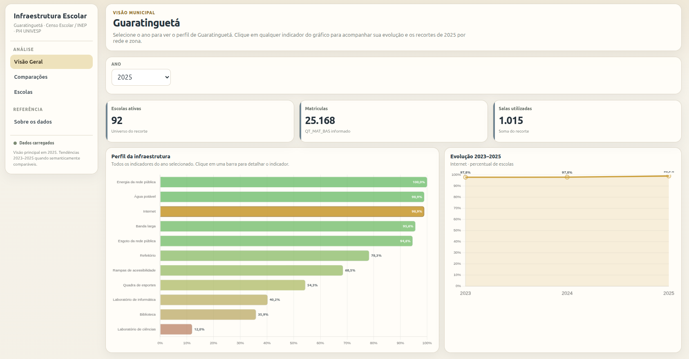
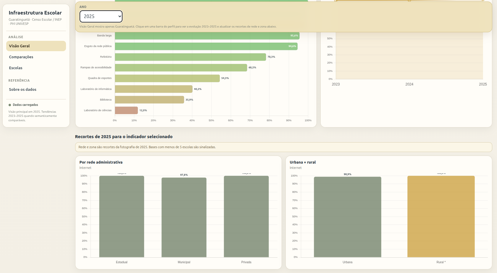
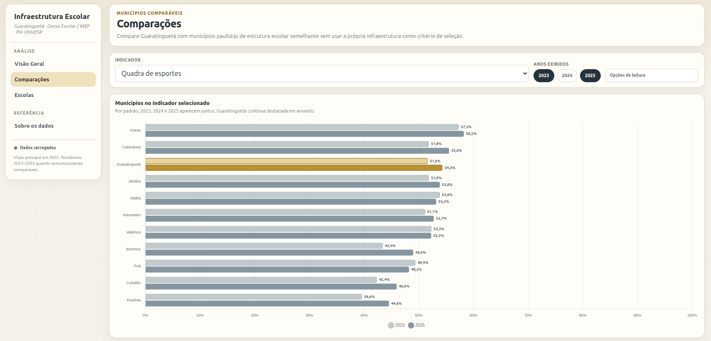
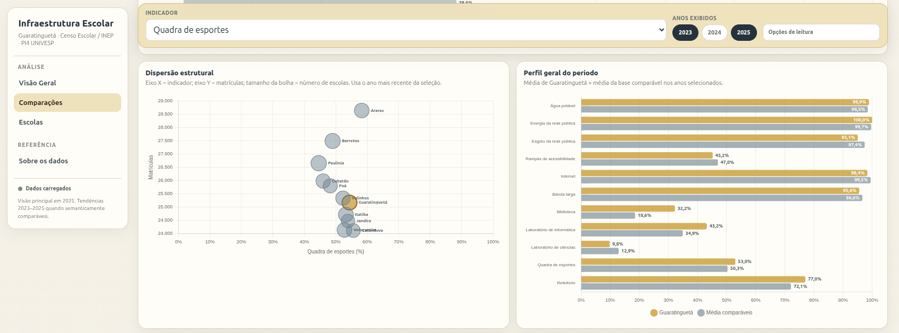
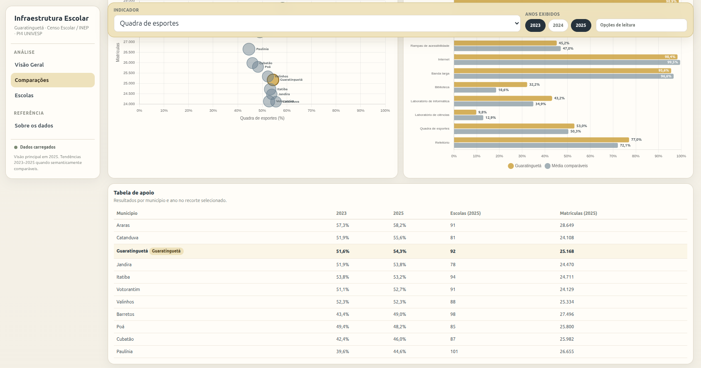
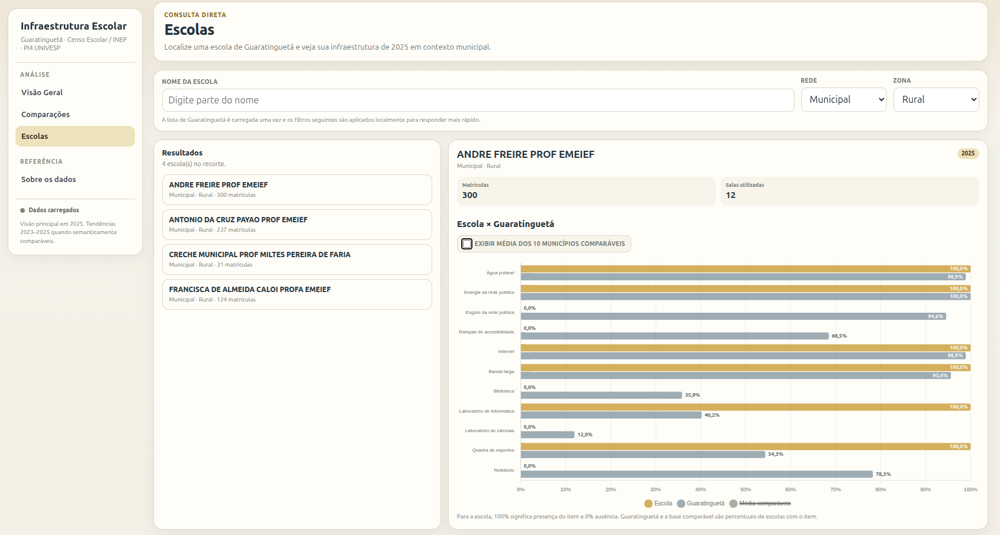
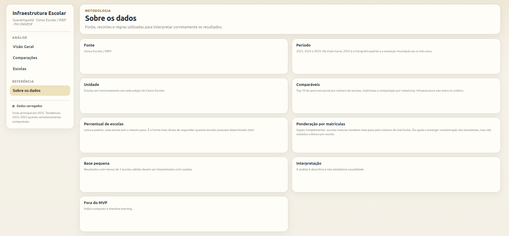

# Interface do Web App — galeria de capturas

O Web App do Projeto Integrador 4 da UNIVESP apresenta uma exploração interativa dos dados públicos de infraestrutura escolar de Guaratinguetá (SP), com recorte temporal de 2023 a 2025.

[**Abrir o Web App**](https://script.google.com/macros/s/AKfycbwN7KphXDuU-Yhjjv_C9GdCNlhHKb1IeP50xz_Thw_Q6HAXT4woKL-AKjYW26Tm-cvhOQ/exec) · [**Voltar à apresentação do projeto**](../../README.md)

As capturas abaixo documentam as quatro áreas da interface. As letras A, B e C indicam partes consecutivas da mesma página, registradas por rolagem vertical.

## 1. Visão Geral

Painel com indicadores e gráficos descritivos de infraestrutura escolar.

## 2. Comparações

Visualização comparativa de Guaratinguetá e municípios paulistas com estrutura escolar semelhante.

## 3. Escolas

Consulta dos dados de infraestrutura por estabelecimento escolar.

## 4. Sobre os dados

Informações sobre as fontes, os critérios metodológicos e as limitações da análise.

Para resultados numéricos e detalhes metodológicos, consulte [Resultados técnicos consolidados](../RESULTADOS_TECNICOS.md) e [Reprodutibilidade](../REPRODUTIBILIDADE.md).
